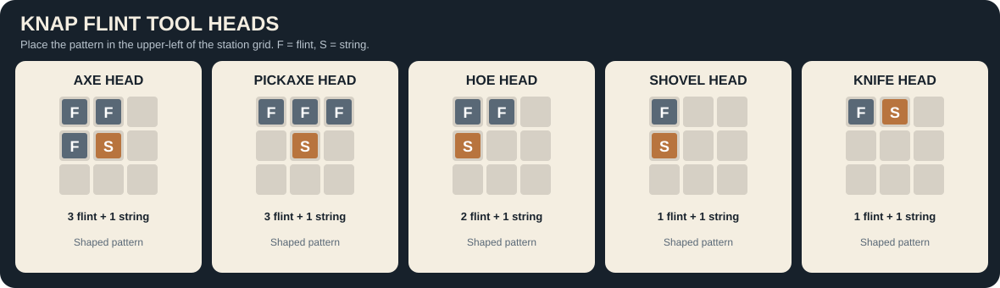
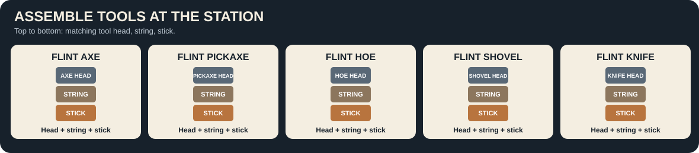
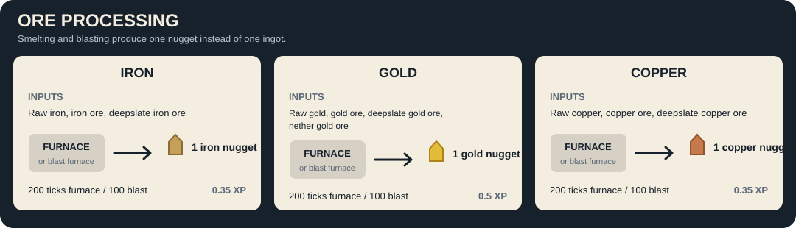

# Primitive Isolation Recipe Wiki

This page lists the custom crafting recipes and vanilla ore-processing recipes changed by Primitive Isolation.

## Knapping and assembly station

Use the **Knapping and Assembly Station** to shape heads and assemble tools. Head patterns must be placed in the upper-left corner of the station's 3x3 grid. In the patterns below, `F` means flint, `S` means string, and `.` means an empty slot.

Craft the station with this shaped recipe (`P` means any planks):

```text
PPP
F F
SSS
```



| Result | 3x3 pattern |
| --- | --- |
| Flint axe head | `FF. / FS. / ...` |
| Flint pickaxe head | `FFF / .S. / ...` |
| Flint hoe head | `FF. / S.. / ...` |
| Flint shovel head | `F.. / S.. / ...` |
| Flint knife head | `FS. / ... / ...` |

Assemble each tool in the station's center column. `H` is the matching tool head, `T` is string, and `S` is a stick:



```text
.H.
.T.
.S.
```

Use the corresponding axe, pickaxe, hoe, shovel, or knife head in the top slot. Each recipe also requires exactly 1 string and 1 stick in the positions shown.

Flint tools use the same harvest tier as wooden tools and have 29 durability (wood tools have 59). Flint axes, pickaxes, hoes, and shovels retain their existing speed and attack stats.
Log blocks only drop wood when harvested with an axe, including the flint axe.

## Animal butchering

Craft a **Butchery Table** with 3 planks and 4 sticks (`PPP / S.S / S.S`, where `P` is any plank and `S` is a stick).

Cows, pigs, chickens, mooshrooms, sheep, rabbits, polar bears, and hoglins leave a ground carcass when killed. Right-click a carcass with an empty hand to pick it up as an item. To field-butcher it instead, hold a flint knife and keep using it for 30 seconds; this yields less than processing it on the table. Left-clicking does not harvest the carcass. Each uncollected carcass decomposes after 5 minutes.

For the larger yield, right-click the Butchery Table while holding the carcass to place it on the table. The table displays which animal is loaded. Hold right-click on the loaded table with a flint knife for 10 seconds to process it, or use an empty hand to pick it back up.

JEI lists each carcass as an input at the Butchery Table. Variable yields display their possible range.

| Carcass | Butchery Table yield |
| --- | --- |
| Cow | 3 raw beef, 2 raw hide, 1 bone |
| Pig | 3 raw pork |
| Chicken | 2 raw chicken, 1 feather, 1 bone |
| Mooshroom | 1–3 raw beef, 0–2 raw hide |
| Sheep | 1–2 raw mutton |
| Rabbit | 0–1 raw rabbit |
| Polar bear | 1 raw fish; cod (75%) or salmon (25%), never both |
| Hoglin | 2–4 raw pork |

Items that do not fit in the player's inventory when processed are discarded.

JEI also lists field butchering separately. Hold a flint knife on the matching corpse for 30 seconds; field yields are lower than table yields.

## Charcoal pit

Craft a **Charcoal Pit Core** from 4 dirt and 1 flint (`D.D / .F. / D.D`). Place the core in the center of an odd-sized 3x3, 5x5, 7x7, or 9x9 footprint; the core itself takes up the center spot, and every other spot must contain a log. For example, a 9x9 footprint needs 80 logs. Cover each log with dirt, grass, or clay, then build a one-block-thick dirt/grass/clay wall around the footprint, including its corners. The 9x9 footprint needs an 11x11 outer wall. Leave only the north and south center blocks of that wall open as vents; keep the block above the core open as the chimney.

Use flint and steel on the core to start the pit. Right-click an active core to check its remaining time. It consumes the logs and yields 1 charcoal per log after 150 ticks per log. Logs can no longer be smelted into charcoal; the charcoal pit is the intended source. A core lasts for a randomly determined **1–10 completed runs**, then burns out and is destroyed.

| Pit size | Logs | Charcoal | Time |
| --- | ---: | ---: | ---: |
| 3x3 | 8 | 8 | 60 seconds |
| 5x5 | 24 | 24 | 3 minutes |
| 7x7 | 48 | 48 | 6 minutes |
| 9x9 | 80 | 80 | 10 minutes |

## Chunk Anchor

Craft a **Chunk Anchor** with an Eye of Ender in the center and iron ingots in all eight surrounding crafting slots. By default, right-click it with an Ender Pearl to fuel one hour of loading for its chunk; additional pearls add another hour. The `chunkAnchorRequiresFuel` common config option defaults to `true`; set it to `false` to keep chunks with Chunk Anchors loaded without fuel. Each anchor affects only its own chunk, and removing the last active anchor stops forcing that chunk to stay loaded.

## Food spoilage and preservation

Butchered meat is modded food. Raw meat and fish spoil after **20 minutes** and turn into rotten flesh. Vanilla loot-table drops of raw meat and fish are replaced with modded perishable versions, and existing dropped items/player inventory stacks are converted too, so vanilla cooking recipes cannot bypass spoilage. Their tooltips show the remaining time before spoilage.

Craft a **Salting Rack** with 6 planks and 2 sticks (`PPP / S S / PPP`). Load up to 3 raw meat or fish pieces across the top row, put salt below them, and collect the salted food from the bottom row. It processes one piece at a time, taking **1 minute per piece** and consuming **2 salt per piece**. JEI lists the salted-food recipes and accepts either vanilla raw foods or the modded perishable raw versions. Fresh meat and fish spoil after **20 minutes**; salting extends that time by 1.5x, to **30 minutes**. Mutton and rabbit meat can also be salted. The timer continues while food is in the rack; spoiled input is removed and rotten flesh drops beside the rack.

The **Drying Rack** turns one tanned hide into leather. JEI lists this processing recipe with the rack as its station. Clear outdoor drying takes **10 minutes**; indoor drying takes **20 minutes**. Exposed rain pauses drying, and a lit campfire within 3 blocks doubles the drying rate.

## Gathering wild plants

Wild barley generates in plains, meadows, and savannas; wild turnips in forests and birch forests; wild berries in taigas; yarrow in meadows, flower forests, and plains; and bitterleaf in swamps, mangrove swamps, and dark forests. Harvest plants by right-clicking them. Use a **Digging Stick** to harvest wild turnips. Each gathered plant item can be planted on suitable ground to regrow that species; plants do not regrow after harvest.

Craft a **Field Guide** from a book surrounded by paper. Right-click while holding it to browse identified entries with previous/next buttons. Use it on a growing plant to save its category, habitat, harvest method, raw effects, and preparation details; unidentified plant details stay hidden until recorded. Eating raw bitterleaf causes poison for 5 seconds. Yarrow restores a small amount of health and removes poison.

Craft a **Plant Dryer** from planks and sticks. Place one yarrow or bitterleaf in its input slot; after **1 minute**, collect dried yarrow or prepared bitterleaf from the output. Prepared bitterleaf is safe to eat. This dryer is separate from the hide Drying Rack and does not preserve food.

Smokers turn salted food into smoked food with **5x the salted timer**, or **150 minutes**. Smoked meat and fish can be stored in a **Preserving Bin**, crafted with 8 planks around a chest (`PPP / PCP / PPP`). The bin has 27 chest-style storage slots and a dedicated slot for Minecraft ice. One ice block preserves all stored perishable food for **2 hours 20 minutes**; food's remaining spoil timer is paused while the bin is chilled and resumes when its ice runs out or is removed. The bin preserves raw, salted, and smoked food according to each item's own spoil duration. Food that spoils in the bin turns into rotten flesh in its storage slot.

Salt comes from natural underwater salt deposits that generate in clay-like patches on water floors. Each deposit drops 4 salt.

## Woven basket

Craft a **Woven Basket** with 4 sugar cane and 3 sticks (`R R / R R / SSS`). A placed basket has **7 slots** and can store food and gathered materials such as plants, sticks, and stones, in normal item stack sizes. Right-click a placed basket to open it; a basket in your inventory cannot be opened. Breaking a filled basket preserves its contents in the dropped basket item, and placing that item restores them.

## Grass fiber, rope, and sleeping mat

Break short grass or tall grass with a flint knife for a **1-in-8 chance** to collect 1 Grass Fiber. Each grass block harvested consumes 1 knife durability. Craft **Rope** from 3 Grass Fibers in a vertical line. Place a rope segment next to a sturdy block or another rope segment; it can then be extended downward and climbed.

Craft a **Sleeping Mat** from 3 wool blocks over 3 hay bales (`WWW / HHH`; any wool color works). It is intended to be usable during the day or night and advance the world clock at 10× for testing until the next morning, without fading the screen to black or changing the player's respawn point. Vanilla beds remain limited to night. **Known bug:** daytime use currently wakes the player immediately instead of advancing time; see issue #4.

| Process | Input | Output |
| --- | --- | --- |
| Salting Rack | 1 raw meat or fish + 2 salt | 1 salted item of the same type (1 minute) |
| Smoker | 1 salted meat | 1 smoked meat of the same type (5 seconds) |
| Smoker | 1 salted fish | 1 smoked fish of the same type (5 seconds) |

Raw cod and salmon can still be cooked in a furnace or smoker to their usual cooked fish.

Use any spear to harvest cod, salmon, tropical fish, or pufferfish with a melee hit while the fish is in water. The hit kills the fish and its normal raw-fish drop is subject to the same spoilage timer.

## Ice shards

Regular ice mined without Silk Touch drops a random **2–4 Ice Shards**. Silk Touch continues to drop the ice block. Craft regular ice with 8 Ice Shards surrounding a snow block (`SSS / SNS / SSS`).

## Ore processing

Each input listed below can be processed in either a furnace or a blast furnace. Each recipe produces **1 nugget** instead of an ingot.



| Metal | Smeltable and blastable inputs | Experience per smelt |
| --- | --- | ---: |
| Iron | Raw iron, iron ore, deepslate iron ore | 0.35 XP |
| Gold | Raw gold, gold ore, deepslate gold ore, nether gold ore | 0.5 XP |
| Copper | Raw copper, copper ore, deepslate copper ore | 0.35 XP |

Furnace recipes take 200 game ticks; blast furnace recipes take 100 game ticks. Experience is awarded when the finished nugget is collected.

## Miscellaneous features

Craft a **Hand Drill** with 2 sticks and any plank (`S. / SP`). Hold use on an unlit campfire or charcoal pit for 5 seconds to light it; each successful use consumes durability. A hand drill cannot relight a campfire while it is exposed to rain.

Right-click a log with an axe to strip it and collect 1 bark.

Lit campfires exposed to rain go out and can be relit with flint and steel. Lit campfires can start normal fire beside flammable wood blocks within 2 blocks in any direction. Each nearby wooden block has an independent chance to ignite, averaging about once per minute while the campfire is lit. Keep campfires away from wooden structures.

Zombies will attack cows, pigs, and chickens.
